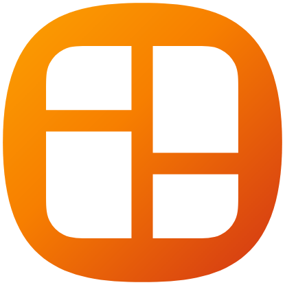
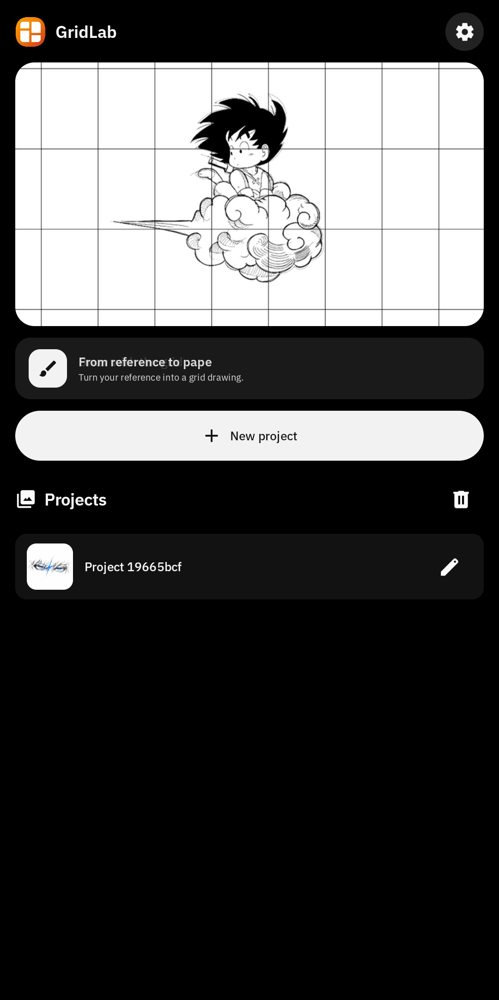
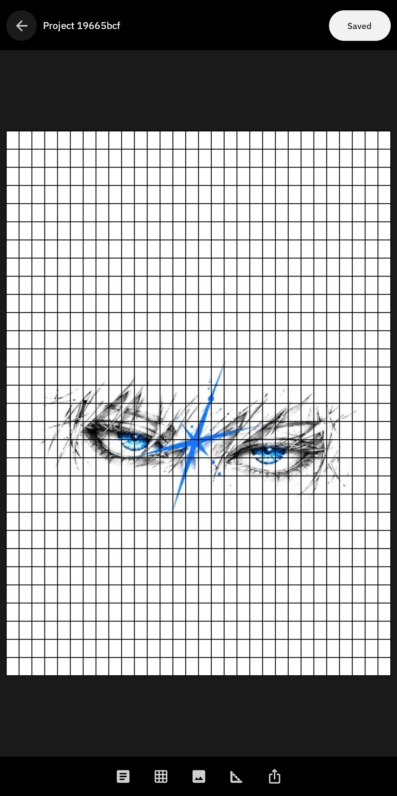
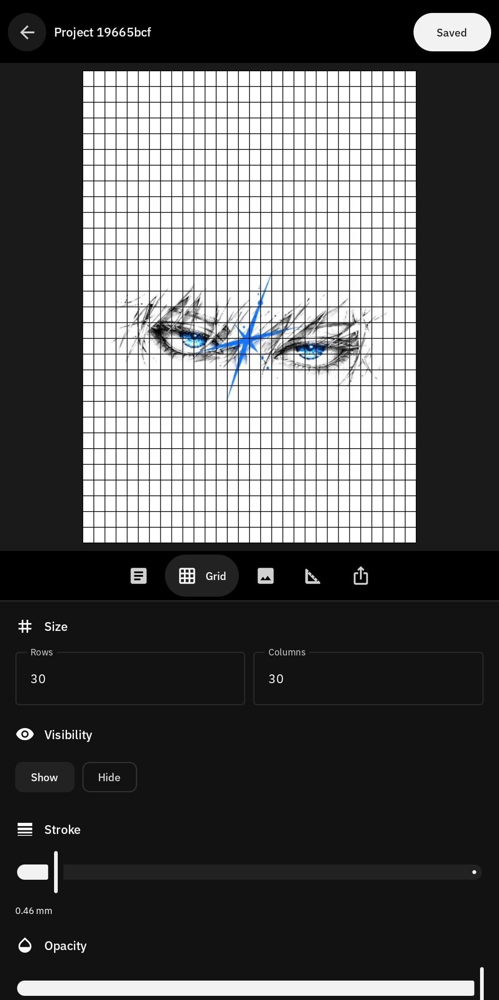

[🇬🇧 English](README.md) | [🇪🇸 Español](README-es.md)

# GridLab

**Convierte imágenes de referencia en dibujos basados en cuadrícula.**

Una herramienta Android de código abierto para artistas, estudiantes y cualquiera que quiera reproducir una imagen en papel usando la técnica de dibujo por cuadrícula.

[Código fuente](https://github.com/boludohh/GridLab) · [Releases](https://github.com/boludohh/GridLab/releases) · [Reportar un problema](https://github.com/boludohh/GridLab/issues)

---

## ¿Qué es GridLab?

GridLab te ayuda a transferir una imagen de referencia a papel físico mediante la **técnica de dibujo por cuadrícula**. Reúne la configuración del papel, la cuadrícula de dibujo y la imagen de referencia en un solo espacio de trabajo, de modo que puedas configurarlos de forma independiente y ver cómo encajan antes de dibujar.

Crea un proyecto, elige el papel que vas a usar, configura las divisiones de la cuadrícula, posiciona tu imagen de referencia y exporta el resultado como guía para tu proceso de dibujo.

GridLab está diseñado para mantener el proceso flexible: no estás limitado a un tamaño de papel fijo, una cuadrícula cuadrada o una única forma de organizar tu referencia.

## Capturas de pantalla

<table>
  <tr>
    <td align="center" width="33%"></td>
    <td align="center" width="33%"></td>
    <td align="center" width="33%"></td>
  </tr>
</table>

## Características

### Configuración del papel
- Elige formatos de papel ISO desde A0 hasta A5, o define un tamaño de papel personalizado.
- Cambia entre orientación vertical y horizontal.
- Configura los márgenes del papel y comprueba el área imprimible resultante.
- Trabaja en milímetros, centímetros o pulgadas.

### Configuración de la cuadrícula
- Configura el número de filas y columnas de forma independiente.
- Ajusta el grosor de línea, la opacidad y el color.
- Muestra u oculta la cuadrícula.
- Añade subdivisiones secundarias dentro de cada celda principal.
- Muestra números de columna y etiquetas de fila para facilitar la localización de celdas.

### Imagen de referencia
- Importa una imagen desde tu dispositivo.
- Mueve y escala la imagen para posicionarla dentro del área imprimible.
- Ajusta la opacidad, la rotación y la visibilidad.
- Bloquea la imagen para evitar cambios accidentales.
- Aplica filtros no destructivos de escala de grises o alto contraste.
- Recorta la referencia sin modificar el archivo de imagen original.

### Medición
- Coloca dos puntos en la vista previa del papel para medir la distancia entre ellos.
- Visualiza la medición usando la unidad de papel seleccionada.

### Proyectos y exportación
- Mantén proyectos separados para distintos dibujos.
- Reabre y continúa editando configuraciones de proyecto guardadas.
- Exporta la guía de dibujo compuesta como **JPG, PNG o PDF**.
- Selecciona una resolución de exportación (DPI); GridLab comprueba la memoria disponible del dispositivo e indica una resolución segura.

## Cómo funciona

1. **Crea un proyecto.** Cada proyecto guarda su propia configuración de papel, cuadrícula e imagen de referencia.
2. **Configura tu papel.** Selecciona un formato estándar o introduce dimensiones personalizadas, orientación, unidades y márgenes.
3. **Configura la cuadrícula.** Elige filas y columnas, y luego personaliza su apariencia y las subdivisiones o etiquetas opcionales.
4. **Añade tu referencia.** Importa una imagen y ajusta su posición, escala, rotación, opacidad, recorte o filtro.
5. **Usa la vista previa.** Revisa la relación entre el papel, la imagen de referencia y la cuadrícula mientras haces ajustes.
6. **Exporta tu guía.** Guarda un JPG, PNG o PDF y úsalo como referencia mientras dibujas en papel.

## Disponibilidad

- **Plataforma:** Android
- **Versión mínima de Android:** Android 8.1 (API 27)
- **Idiomas:** Inglés y Español
- **Licencia:** GNU General Public License v3.0 (GPL-3.0)

GridLab es una aplicación Android construida con Kotlin, Jetpack Compose, Material 3, Room, DataStore y Hilt.

## Estado del proyecto

Esta es la **primera versión pública** de GridLab. La versión inicial se centra en ofrecer el flujo de trabajo principal de dibujo por cuadrícula: gestión de proyectos, configuración de papel y cuadrícula, ajustes de imagen de referencia, medición y exportación.

La interfaz y la experiencia general pueden evolucionar en futuras versiones. Los reportes de errores, problemas reproducibles y sugerencias prácticas son bienvenidos a través del [rastreador de issues de GitHub](https://github.com/boludohh/GridLab/issues).

## Documentación

- [File index (English)](docs/architecture/FILES.md)
- [Índice de archivos (Español)](docs/architecture/FILES-es.md)

## Contribuciones

Las contribuciones y reportes de problemas son bienvenidos. Antes de proponer un cambio, por favor revisa la estructura del proyecto y las responsabilidades de los archivos documentadas arriba. Al reportar un problema, incluye la versión de Android, el modelo del dispositivo cuando sea relevante, los pasos para reproducir el problema y el comportamiento esperado frente al comportamiento real.

## Licencia

GridLab se distribuye bajo la [GNU General Public License v3.0](LICENSE).

Las bibliotecas de terceros y sus licencias están listadas dentro de la aplicación en **Ajustes → Licencias de código abierto** y en los archivos correspondientes dentro de `app/src/main/assets/licenses/`.
